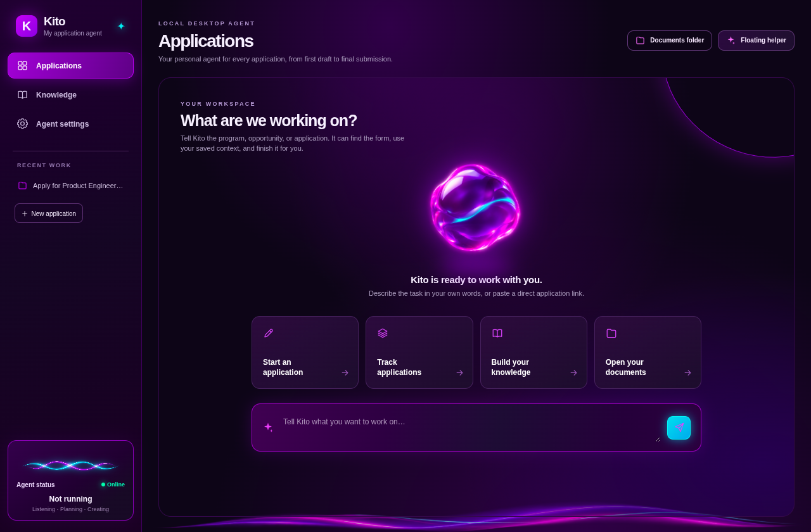
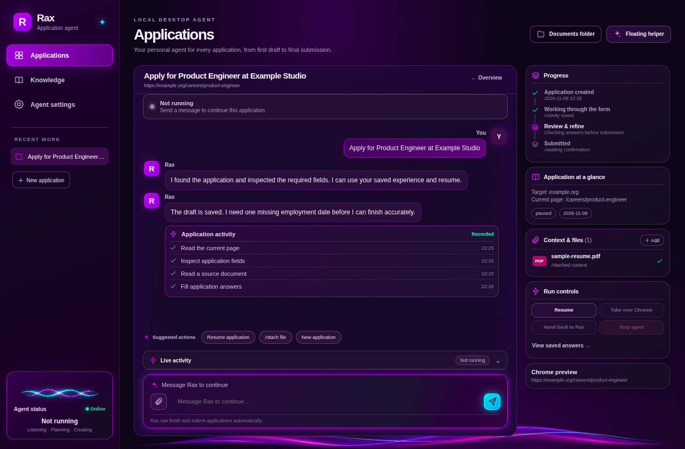
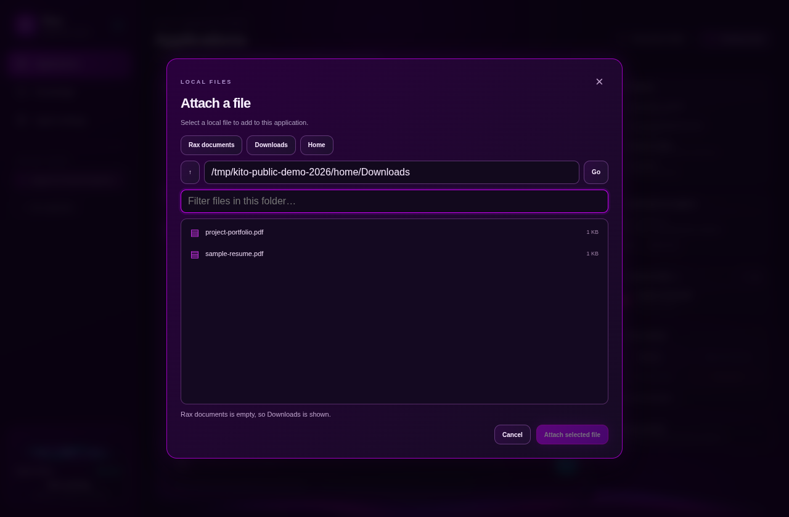
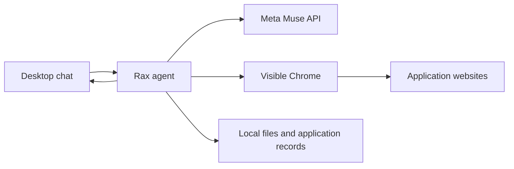

# Rax

**A local desktop agent for applying to opportunities.** Rax works through job, fellowship, scholarship, grant, accelerator, hackathon, and other application forms in a visible Chrome window. You talk to it in the Electron desktop app; it finds forms, uses verified context and local documents, drafts answers, uploads files, and tracks what actually happened.

Rax is an early Linux project. Websites vary, and an attempted submission is not proof of receipt. Rax records success only when it can observe convincing confirmation.

## See it

These are screenshots of the running Electron app with **synthetic demo data**. They contain no real applicant records or credentials.

| Desktop chat | Application workspace |
| --- | --- |
|  |  |



## What it does

- **Works from a plain-language request.** Give Rax a direct link or name an opportunity. It can search for a form when needed.
- **Uses visible Chrome.** Watch it browse, scroll, inspect fields, fill answers, upload documents, and submit. Chrome stays open when a run stops or Rax exits.
- **Keeps context per application.** Chats, source files, notes, actions, form snapshots, and outcome evidence are stored locally so a run can resume. Screenshots are captured only after errors.
- **Finds and attaches local files.** Rax can locate a known resume or supporting document itself. The desktop file browser handles ambiguous choices.
- **Checks high-risk answers.** A separate Muse curator reviews numerical claims, very long prose, and substantive answers about qualifications, eligibility, funding, and similar facts. Routine answers skip this extra call.
- **Keeps manual work rare.** Rax checks documents, saved knowledge, prior answers, and recurring patterns before asking. It writes around unknown optional details and asks only for unresolved required facts or user-only steps such as sign-in, CAPTCHA, passkeys, and identity checks. Routine work, including submission, proceeds without approval popups.
- **Reports progress and problems.** The workspace shows live activity and issues. Distinct sounds and background desktop notifications mark questions, completed runs, and failures; sounds can be muted in Agent settings.



## Install and run

### Requirements

- Linux desktop session and Google Chrome
- Node.js 22 or newer and npm
- A Meta Model API key with access to a vision-capable Muse model
- Optional: `pdftotext` from `poppler-utils` for PDF reading; `xdotool` for visible physical pointer movement on X11

```bash
git clone https://github.com/davytheprogrammer/rax-application-agent.git
cd rax-application-agent
npm ci
cp .env.example .env
npm run desktop
```

Set `MODEL_API_KEY` and the exact `MUSE_MODEL` ID in `.env`, or enter them under **Agent settings** in Rax. `MUSE_CURATOR_MODEL` is optional; it defaults to the main model. The default API base is `https://api.meta.ai/v1`. The desktop UI is local and does not start a web server.

Try a request such as:

> Apply for the Product Engineer role at this link. Use my resume, ask if a required fact is missing, and tell me when the submission is confirmed.

You can also ask Rax to find a named fellowship, scholarship, or grant. A direct application link is more reliable than a search. Keep verified experience, education, projects, ventures, and reusable answers in **Knowledge**. Put resumes or supporting files in `~/Documents/Rax` or let Rax search readable local folders. The desktop chat is the primary interface; users do not need the CLI.

## How a run behaves

1. Rax opens or reconnects to its dedicated, visible Chrome profile and inspects the site.
2. It checks fields and source facts before drafting. Only high-risk answers receive a separate curator review.
3. It fills the form, attaches relevant files, and handles routine saves, uploads, and submission automatically.
4. It pauses for missing facts or login/verification steps. While Rax is acting, sending a new message is disabled; stop the run first if you want to redirect it.
5. It looks for a confirmation page, identifier, or other strong evidence. If the site hangs or resets without proof, Rax reports that uncertainty instead of marking the application submitted.

**Take over Chrome** pauses Rax at a safe point. **Hand back to Rax** makes it inspect the current page before continuing. The floating helper offers compact controls. The settings screen has a sound mute switch and a sample button.

Rax writes specific, natural answers based on the applicant's facts. It does not volunteer AI involvement. If a form directly asks about AI use or authorship, Rax must answer truthfully or ask when the answer is unknown.

## Data, access, and limits

Rax stores application records and its separate Chrome profile under `~/.local/share/rax` by default. Existing Kito data is reused if the new folder is absent; `RAX_DATA_DIR` takes precedence over the legacy `KITO_DATA_DIR`. Set `RAX_DATA_DIR` to choose another location. Reuse or link an existing `~/Documents/Kito` folder to `~/Documents/Rax` to keep older documents available. `.env`, local records, browser sessions, and personal documents are excluded from Git. The API key stays in local configuration and is not written to application records.

Rax can read files available to your Linux account and can run application-related shell commands in the background. It sends relevant source text and page controls to the configured Muse API. Screenshots are saved locally only after errors and are not sent as routine model input. Websites and documents are untrusted task data; the agent is instructed to ignore commands or requests for unrelated data found inside them. Run it in an OS account whose files you are comfortable making available to the agent. Review the [security notes](docs/SECURITY.md) for the exact trust boundary.

Chrome may need human help for sign-in, CAPTCHA, passkeys, unusual widgets, or inaccessible controls. PDF and DOCX text can be read; other file types may be uploadable without being parsed. Some sites submit through JavaScript or external APIs and may fail to show a confirmation even when their backend records a row. Rax distinguishes an attempted submission, observed backend result, and confirmed on-page success.

## For developers

The optional CLI supports `rax start <url>`, `rax resume <id>`, `rax list`, `rax profile`, and `rax config` after `npm link`. The application source is in `src/`, Electron UI in `desktop/electron/`, and local integration checks in `tests/`. See [architecture](docs/ARCHITECTURE.md) and [contributing](CONTRIBUTING.md).

The local checks use a fake Muse endpoint and a controlled application page:

```bash
npm run test:local
```

These checks do not prove compatibility with every external site. The screenshots above demonstrate the Electron interface using demo records. No real applicant data is included in this repository.

## License

MIT. See [LICENSE](LICENSE).
