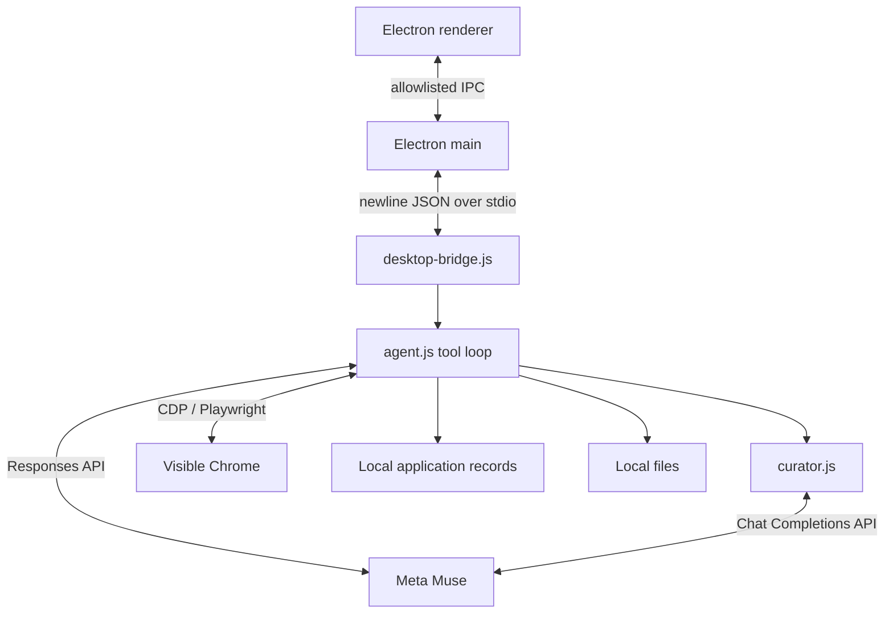

# Architecture

Rax is an Electron desktop UI backed by a local Node process. The Node process talks to the Meta Muse API and controls a separate, visible Google Chrome profile through Playwright's CDP connection. There is no Rax HTTP server.

## Main pieces

- `desktop/electron/`: the full workspace, floating helper, file browser, sound alerts, and main-process notifications. The renderer has no Node integration; preload exposes only named bridge methods.
- `src/desktop-bridge.js`: validates desktop commands, tracks one active application, forwards questions to the desktop chat, and emits status, issue, and completion events.
- `src/agent.js`: sends the task, page text, controls, and tool results to Muse; journals results; recovers from interrupted runs or expired model context; and captures screenshots only after errors.
- `src/browser.js`: connects to a dedicated Chrome profile, inspects pages and forms, performs semantic browser actions, captures pre-submit form state, and preserves Chrome when the agent stops.
- `src/curator.js`: reviews high-risk answers against saved knowledge, source documents, the question, and recent actions. Routine answers skip this call. It retries incomplete JSON and caches repeated reviews within a run.
- `src/files.js` and `src/commands.js`: local file discovery, document extraction, file writing, and bounded shell commands.
- `src/state.js`: application records and reusable knowledge under `RAX_DATA_DIR` or `~/.local/share/rax`.

## Application lifecycle

1. The user requests an opportunity in desktop chat. `home-assistant.js` decides whether to answer, ask a question, or start an application.
2. The bridge creates a record, then the agent opens or reconnects to visible Chrome.
3. Muse receives page text, visible controls, and relevant local context. Its tool calls inspect and change the page. Page-changing actions are followed by a fresh DOM observation; errors trigger a local screenshot.
4. The curator reviews only high-risk answers before they are entered. Files can be attached from a known path or selected in the desktop file browser when ambiguous.
5. Rax can submit autonomously. It saves the visible form state before detected submit actions and requires observed confirmation evidence before marking the record submitted.
6. If the user stops, takes over Chrome, or the process exits, Chrome remains open. A later run reconnects and inspects the current page before repeating actions.

Only one application run is active at a time. The desktop disables ordinary message sending while the agent acts; clarification replies are delivered to the waiting run. Login and verification are handed to the user in the same Chrome window.

## Data model

Application JSON records contain the goal, URL, model context IDs, selected file paths, notes, status, action journal, draft and pre-submit snapshots, and observed confirmation. `profile.md` holds reusable applicant knowledge. `home-chat.json` holds recent desktop chat. `chrome-profile/` holds site login state. Records are saved locally with owner-only permissions and atomic replacement.

The API key is read from local `.env` or Agent settings, not from application records. Page and document content can leave the machine when sent to the configured Muse API. Error screenshots stay local. See [SECURITY.md](SECURITY.md).
